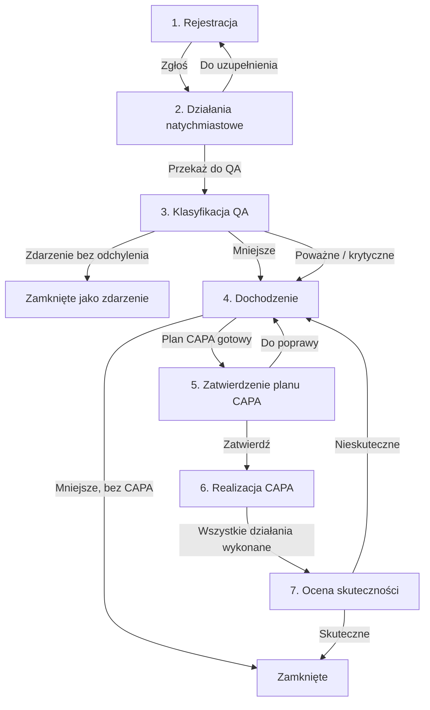

# WEBCON BPS – Odchylenia GMP i działania CAPA w zakładzie farmaceutycznym

Projekt aplikacji procesowej pod platformę low-code **WEBCON BPS** dla wytwórni produktów leczniczych. Obsługuje odchylenie od zatwierdzonej instrukcji, procedury (SOP) lub specyfikacji od zgłoszenia na linii przez klasyfikację w dziale zapewnienia jakości (QA), dochodzenie i analizę przyczyny, aż po działania korygujące i zapobiegawcze (CAPA) oraz sprawdzenie ich skuteczności.

Dlaczego taki proces: obsługa odchyleń i CAPA to jeden z obszarów, które inspektorzy GMP wskazują najczęściej. W zestawieniach niezgodności z inspekcji badanie anomalii jest na pierwszym miejscu, a CAPA na trzecim ([GMP Compliance, ECA](https://www.gmp-compliance.org/gmp-news/handling-of-deviations-and-capa-criticised-by-inspectorates)). Dobrze zaprojektowany obieg w systemie elektronicznym daje terminy, ślad audytowy i raporty trendów zamiast papierowych formularzy.

> **Status projektu.** Repozytorium zawiera projekt procesu (obieg, formularz, role, reguły), skrypty T-SQL (słowniki, rejestr do raportów, ślad audytowy, dane testowe, raporty), szablon wydruku raportu z odchylenia (HTML/CSS) i scenariusze testowe. Konfiguracja w WEBCON BPS Designer Studio jest kolejnym krokiem (lista na dole). Projekt nie jest systemem zwalidowanym i nie zastępuje procedur zakładu.

Powiązany projekt: [`webcon-kontrola-zmian-gmp`](https://github.com/olivex333/webcon-kontrola-zmian-gmp) – działanie CAPA wymagające zmiany procesu lub dokumentu otwiera wniosek o zmianę.

## Zawartość

| Plik | Co zawiera |
| --- | --- |
| [`docs/obieg.md`](docs/obieg.md) | diagram obiegu, kroki, ścieżki, uprawnienia, akcje automatyczne |
| [`docs/gmp_i_annex11.md`](docs/gmp_i_annex11.md) | jak projekt odpowiada na wymagania GMP i Aneksu 11 (ślad audytowy, podpis, dostęp) |
| [`docs/ocena_projektu.md`](docs/ocena_projektu.md) | uczciwa ocena: co ma sens, ograniczenia, co zrobić dalej |
| [`sql/01_slowniki.sql`](sql/01_slowniki.sql) | słowniki: linie, produkty, kategorie odchyleń, kategorie przyczyn |
| [`sql/02_rejestr_i_audit.sql`](sql/02_rejestr_i_audit.sql) | rejestr odchyleń i CAPA na potrzeby raportów, tabela śladu audytowego, trigger |
| [`sql/03_dane_testowe.sql`](sql/03_dane_testowe.sql) | fikcyjne dane testowe |
| [`sql/04_raporty.sql`](sql/04_raporty.sql) | raporty: otwarte odchylenia wg klasy i wieku, przeterminowane dochodzenia, trendy przyczyn, skuteczność CAPA |
| [`templates/raport_odchylenia.html`](templates/raport_odchylenia.html) | wydruk raportu z odchylenia (HTML/CSS) |
| [`tests/scenariusze_testowe.md`](tests/scenariusze_testowe.md) | 15 scenariuszy testowych |
| [`docs/ai_w_projekcie.md`](docs/ai_w_projekcie.md) | jak używam AI i jak weryfikuję jego wyniki |

## Role

| Rola | Kto w zakładzie | Co robi w obiegu |
| --- | --- | --- |
| Zgłaszający | operator, technolog, laborant | rejestruje odchylenie, opisuje zdarzenie, wskazuje serię |
| Kierownik obszaru | kierownik produkcji lub laboratorium | podejmuje działania natychmiastowe, decyduje o wstrzymaniu serii |
| QA – specjalista | dział zapewnienia jakości | klasyfikuje odchylenie, wyznacza prowadzącego dochodzenie |
| Prowadzący dochodzenie | ekspert z obszaru | analiza przyczyny (5 Why, Ishikawa), ocena wpływu na serie, plan CAPA |
| Właściciel działania CAPA | osoba z dowolnego działu | realizuje przypisane działanie |
| QA – kierownik | kierownik QA | zatwierdza plan CAPA, ocenia skuteczność, zamyka odchylenie |

## Obieg

Szczegóły kroków: [`docs/obieg.md`](docs/obieg.md).

## Formularz

| Pole | Typ pola w WEBCON | Krok | Uwagi |
| --- | --- | --- | --- |
| Numer odchylenia | sygnatura | auto | `DEV/{rok}/{numer}` |
| Data i godzina zdarzenia, data wykrycia | data i godzina | 1 | wykrycie ≥ zdarzenie |
| Obszar / linia | wybór (źródło SQL) | 1 | `dbo.Slownik_Linie` |
| Produkt i numer serii | wybór + tekst | 1 | kilka serii: lista pozycji |
| Kategoria odchylenia | wybór (źródło SQL) | 1 | proces, sprzęt, materiał, dokumentacja, środowisko |
| Opis zdarzenia | tekst wielowierszowy | 1 | co, gdzie, kiedy, kto wykrył |
| Działania natychmiastowe | tekst wielowierszowy | 2 | np. zatrzymanie linii, segregacja |
| Status serii | wybór: zwolniona / wstrzymana (kwarantanna) | 2 | wstrzymanie obowiązkowe przy podejrzeniu wpływu na jakość |
| Klasyfikacja | wybór: zdarzenie / mniejsze / poważne / krytyczne | 3 | z uzasadnieniem |
| Wymagane CAPA | tak / nie | 3–4 | dla poważnych i krytycznych zawsze „tak” |
| Prowadzący dochodzenie | wybór osoby | 3 | |
| Termin zakończenia dochodzenia | data | 3 | wyliczany z klasyfikacji |
| Przyczyna źródłowa | lista pozycji 5 Why + kategoria przyczyny | 4 | kategoria z `dbo.Slownik_PrzyczynyKategorie` |
| Ocena wpływu na serie i inne produkty | tekst wielowierszowy | 4 | |
| Działania CAPA | lista pozycji: typ (korygujące / zapobiegawcze), opis, właściciel, termin, status | 4–6 | |
| Kryterium i wynik oceny skuteczności | tekst | 4, 7 | kryterium ustalane z góry |

## Reguły biznesowe

1. **Termin dochodzenia z klasyfikacji** (wartości przyjęte w projekcie, do ustawienia wg SOP zakładu): krytyczne 7 dni, poważne 15 dni, mniejsze 30 dni od klasyfikacji.
2. **Poważne i krytyczne zawsze z CAPA.** Ścieżka „Mniejsze, bez CAPA” jest ukryta dla tych klas.
3. **Wstrzymanie serii:** przy klasyfikacji krytycznej status serii musi być „wstrzymana”, a do QA i kierownika produkcji idzie e-mail.
4. **Zamknięcie dopiero po realizacji:** przejście do oceny skuteczności tylko, gdy wszystkie działania CAPA mają status „wykonane”.
5. **Rozdzielenie obowiązków:** zatwierdzający plan CAPA i oceniający skuteczność nie może być prowadzącym dochodzenie.
6. **Kryterium skuteczności z góry:** plan CAPA nie przejdzie dalej bez wpisanego kryterium (np. brak powtórzenia przyczyny na linii przez 90 dni).
7. **Trend przyczyn:** jeśli ta sama kategoria przyczyny wystąpiła na tej samej linii w ostatnich 90 dniach, formularz pokazuje ostrzeżenie i link do poprzednich odchyleń.
8. **Przypomnienia:** e-mail do prowadzącego dochodzenie 3 dni przed terminem i codziennie po jego przekroczeniu.

## Raporty i dashboard

- Otwarte odchylenia według klasyfikacji i wieku (0–15, 16–30, ponad 30 dni)
- Dochodzenia po terminie: kto prowadzi, ile dni opóźnienia
- Trend kategorii przyczyn na liniach (powtarzalność w 90 dniach)
- Skuteczność CAPA: odsetek działań ocenionych jako skuteczne za pierwszym razem
- Średni czas od zgłoszenia do zamknięcia według klasyfikacji

## Konfiguracja w WEBCON BPS (kolejne kroki)

- [ ] Uruchomić skrypty `sql/01`–`03` na bazie pomocniczej i dodać ją jako źródło danych
- [ ] Utworzyć aplikację, proces i obieg z `docs/obieg.md`
- [ ] Dodać pola formularza i listy pozycji (5 Why, działania CAPA, serie)
- [ ] Ustawić widoczność i wymagalność pól na krokach, reguły 1–8
- [ ] Skonfigurować uprawnienia według ról i akcje e-mail
- [ ] Zbudować raporty w Portalu na podstawie zapytań z `sql/04_raporty.sql`
- [ ] Przejść scenariusze z `tests/scenariusze_testowe.md` i dodać zrzuty ekranu

## Technologie

WEBCON BPS (projekt procesu) · T-SQL (Microsoft SQL Server) · HTML/CSS · Mermaid · narzędzia AI do przeglądu, testów i dokumentacji

## Autor

Oliwier Grabarczyk – [github.com/olivex333](https://github.com/olivex333)
